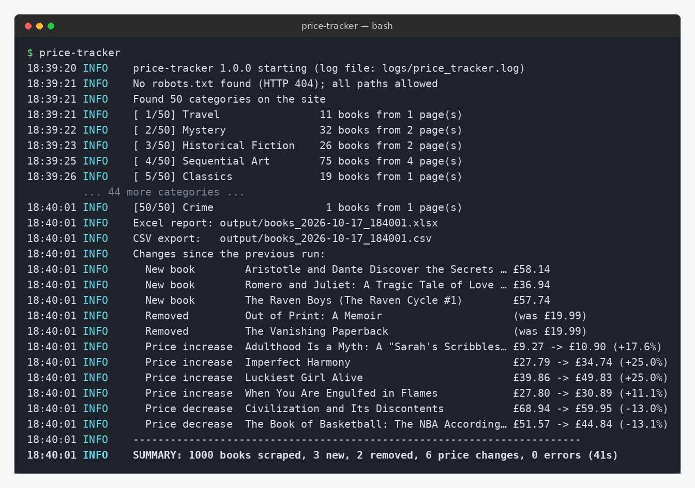
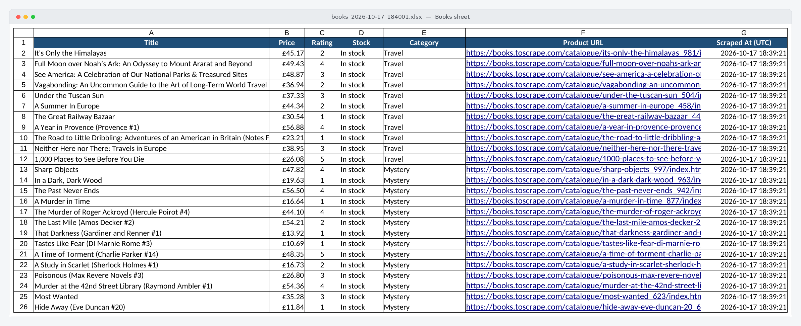
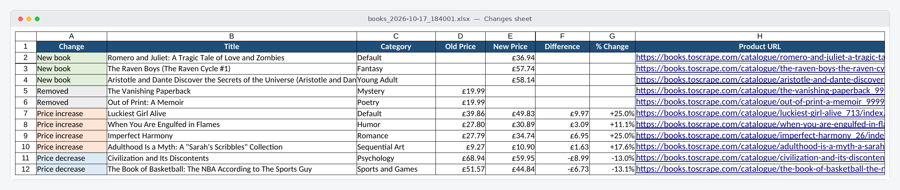

# price-tracker

A polite web scraper that collects every book from
[books.toscrape.com](https://books.toscrape.com) (a sandbox site built for scraping practice),
keeps a **price history in SQLite**, detects **new books, removed books and price changes**
between runs, and exports each run to a **formatted Excel report** and a **CSV file**.
It runs unattended every day on a Linux server using a **systemd timer**.


<sub>A run after some changes were planted (see [Demo](#demo-seeing-change-detection)). The 44 middle category lines are trimmed from the screenshot.</sub>

## Features

| | |
|---|---|
| **Complete coverage** | All 50 categories and every page: 1,000 books in about 40 seconds (~70 requests) |
| **Data per book** | Title, price (GBP), star rating, stock status, category, product URL, scrape timestamp (UTC) |
| **Polite by design** | Obeys `robots.txt` (including `Crawl-delay`), waits between requests, sends a clear User-Agent, retries network errors / HTTP 429 / 5xx with exponential backoff and honours `Retry-After` |
| **Price history** | SQLite database stores every observation, so you can chart any book's price over time |
| **Change detection** | New books, removed books, price increases and decreases, with no false alarms on partial runs |
| **Excel report** | Bold frozen header, filters, auto-sized columns, `£` currency format, clickable links, colour-coded **Changes** sheet, print-ready layout |
| **CSV export** | UTF-8 (opens correctly in Excel, `£` included) |
| **CLI** | `--category`, `--max-pages`, `--output-dir`, plus `--db`, `--log-dir`, `--delay`, `--verbose` |
| **Logging** | Coloured console output plus a rotating log file; ends with a one-line summary |
| **Tested** | 48 pytest tests using saved HTML pages and a fake network, so the tests make no live requests |
| **Deployable** | systemd service and timer, plus a one-command install script |

## Screenshots

**Books sheet**: one row per book, currency-formatted, frozen header, filters on every column.



**Changes sheet**: what changed since the last run, colour-coded, with the difference in £ and %.



Sample files: [`docs/sample_output/books_sample.xlsx`](docs/sample_output/books_sample.xlsx) ·
[`docs/sample_output/books_sample.csv`](docs/sample_output/books_sample.csv)

## Quick start

Requires Python 3.11+.

```bash
git clone https://github.com/spenceco/book-price-tracker.git price-tracker && cd price-tracker
python3 -m venv .venv
source .venv/bin/activate
pip install -r requirements.txt

python -m price_tracker                      # scrape everything
```

Results go to `output/` (Excel + CSV), the history database to `data/price_history.db`,
and the log to `logs/price_tracker.log`.

### Command-line options

```text
python -m price_tracker [options]

  --category NAME    Only scrape this category (case-insensitive). Repeat for several.
  --max-pages N      Maximum listing pages per category (20 books per page).
  --output-dir DIR   Where to write the Excel and CSV files (default: output)
  --db PATH          SQLite price-history database (default: data/price_history.db)
  --log-dir DIR      Folder for the log file (default: logs)
  --delay SECONDS    Pause between requests (default: 0.5)
  -v, --verbose      Show debug messages
```

Examples:

```bash
python -m price_tracker --category Mystery --category Poetry
python -m price_tracker --max-pages 1 --output-dir reports/
```

Exit codes: `0` success · `1` nothing could be scraped · `2` bad `--category` · `3` finished, but some pages failed.

### Example output

```text
18:37:09 INFO    price-tracker 1.0.0 starting (log file: logs/price_tracker.log)
18:37:09 INFO    No robots.txt found (HTTP 404); all paths allowed
18:37:10 INFO    Found 50 categories on the site
18:37:10 INFO    [ 1/50] Travel                11 books from 1 page(s)
18:37:11 INFO    [ 2/50] Mystery               32 books from 2 page(s)
...
18:37:50 INFO    Excel report: output/books_2026-10-17_183750.xlsx
18:37:50 INFO    CSV export:   output/books_2026-10-17_183750.csv
18:37:50 INFO    Changes since the previous run:
18:37:50 INFO      New book        The Raven Boys (The Raven Cycle #1)        £57.74
18:37:50 INFO      Removed         The Vanishing Paperback                    (was £19.99)
18:37:50 INFO      Price increase  Imperfect Harmony                          £27.79 -> £34.74 (+25.0%)
18:37:50 INFO      Price decrease  Civilization and Its Discontents           £68.94 -> £59.95 (-13.0%)
...
18:37:50 INFO    SUMMARY: 1000 books scraped, 3 new, 2 removed, 6 price changes, 0 errors (41s)
```

## How change detection works

* The **first** scrape of a category is a *baseline*: its books are stored, not reported as "new".
* **New book**: a product URL we've never seen, in a category we already track.
* **Price increase / decrease**: a known book whose price differs from the stored one.
* **Removed**: a book we tracked that is missing from a category that was scraped **completely**.
  If a category was cut short (by `--max-pages` or a failed page), removals are not reported for it,
  so a partial run never produces false alarms.

### Demo: seeing change detection

books.toscrape.com is static, so its prices never change. To show the feature working, a demo
script edits the database between two runs:

```bash
python -m price_tracker                    # run 1: baseline
python scripts/simulate_changes.py         # plants 6 price changes, 3 "new", 2 "removed"
python -m price_tracker                    # run 2: reports them
```

The screenshots above came from exactly this sequence.

## Project layout

```text
price-tracker/
├── price_tracker/
│   ├── cli.py            # command-line options; runs scrape -> save -> export -> summary
│   ├── scraper.py        # walks categories and pages
│   ├── parser.py         # HTML -> Book objects (pure functions, easy to test)
│   ├── http_client.py    # polite httpx client: robots.txt, delay, retries, User-Agent
│   ├── storage.py        # SQLite schema, price history, change detection
│   ├── exporter.py       # Excel (openpyxl) and CSV writers
│   ├── models.py         # Book, Category, Change dataclasses
│   ├── logging_setup.py  # console + rotating file logging
│   └── config.py         # defaults in one place
├── tests/                # pytest suite + saved HTML fixtures
├── deploy/               # systemd service, timer and install script
├── scripts/              # demo-change script, screenshot generator
└── docs/                 # screenshots and sample output
```

## Running the tests

```bash
pip install -r requirements-dev.txt
pytest                     # 48 tests, ~1 second, no internet needed
ruff check . && mypy price_tracker
```

## Deploying: run daily with systemd

On the server (Ubuntu/Debian with Python 3.11+):

```bash
git clone https://github.com/spenceco/book-price-tracker.git ~/price-tracker && cd ~/price-tracker
bash deploy/install.sh
```

This creates the virtual environment, installs `price-tracker.service` and
`price-tracker.timer`, and schedules a run **every day at 06:00 UTC**. The timer adds a random
delay of up to 10 minutes, and a run missed while the server was off happens at the next boot.

### Checking on it

```bash
systemctl list-timers price-tracker.timer        # when is the next run? when was the last?
systemctl status price-tracker.service           # did the last run succeed?
journalctl -u price-tracker.service -n 50        # console output of recent runs
journalctl -u price-tracker.service --since today
journalctl -u price-tracker.service -f           # follow live
tail -f ~/price-tracker/logs/price_tracker.log   # detailed app log (DEBUG level)
ls -lt ~/price-tracker/output | head             # latest reports

sudo systemctl start price-tracker.service       # run right now
sudo systemctl disable --now price-tracker.timer # stop the schedule
```

## Regenerating the screenshots

`scripts/make_screenshots.py` converts each Excel sheet to PDF with **LibreOffice headless**,
turns it into an image with `pdftoppm`, and draws the terminal capture with Pillow:

```bash
sudo apt install libreoffice-calc-nogui poppler-utils fonts-dejavu fonts-crosextra-carlito
FORCE_COLOR=1 python -m price_tracker > run.ansi
python scripts/make_screenshots.py output/books_<stamp>.xlsx run.ansi docs/screenshots
```

## Adapting it to another site

Only `parser.py` (CSS selectors) and `config.BASE_URL` are specific to books.toscrape.com.
The polite client, history database, change detection, reports and deployment can be reused as they are.

## Responsible scraping

This project targets a site made for scraping practice. For any real site, check its
terms of service and `robots.txt`, keep the request rate low, and set
`PRICE_TRACKER_USER_AGENT` so it includes your contact details.
